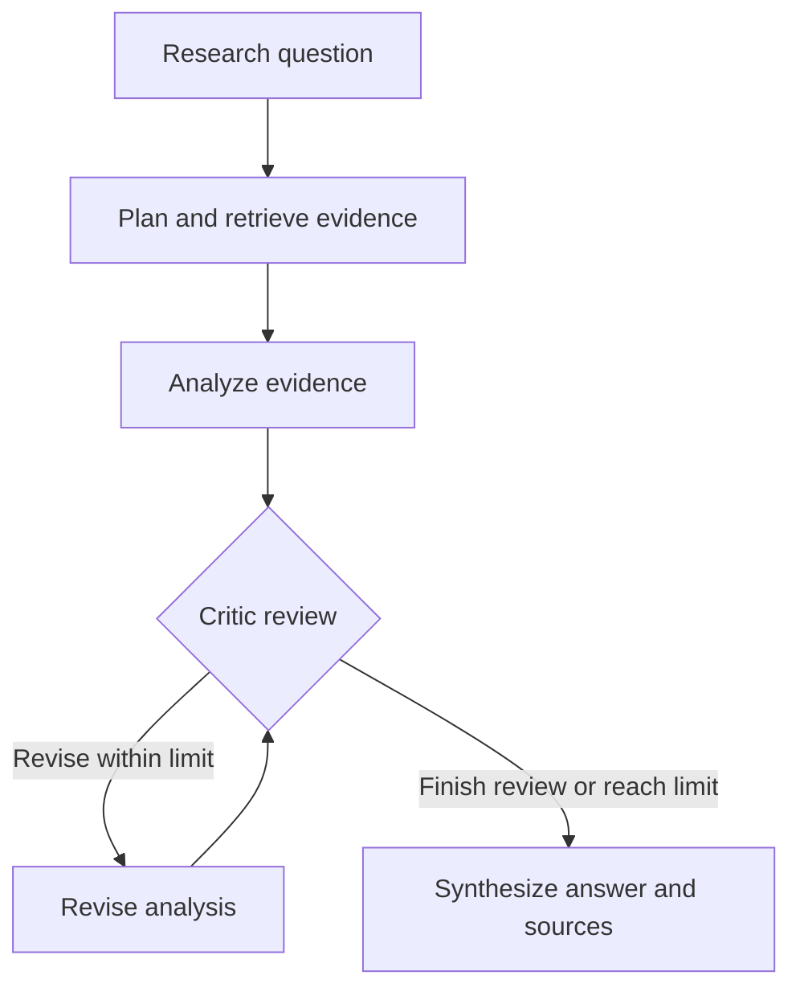

# Agentic RAG Research Assistant

A research workspace for discovering papers, asking questions about uploaded PDFs, comparing findings, creating editable diagrams, and drafting project documents.

The primary application uses **FastAPI with an HTML, CSS, and JavaScript interface**. A companion **Streamlit application** remains available in `app.py`.

## What you can do

| Area | Current features |
| --- | --- |
| Research | Ask questions about one paper or all papers in the selected workspace; use simple or technical explanations |
| Paper library | Upload multiple PDFs, inspect page and passage counts, filter filenames, preview PDFs, and remove papers |
| Evidence | Inspect retrieved passages and open the corresponding PDF page |
| Paper discovery | Search arXiv by topic with an optional publication-year filter; follow links to read or download papers |
| Research history | Reopen completed answers saved to the selected workspace |
| Diagrams | Generate flowcharts, system architecture, sequence, and entity-relationship diagrams as Mermaid source |
| Diagram editing | Preview diagrams, edit source, refine through instructions, rename, save versions, and restore earlier versions |
| Project writer | Draft and edit individual project sections, preview the full document, and autosave drafts in the browser |
| Exports | Download research reports and project documents in several formats |
| Interface | Responsive navigation, dark mode, research shortcuts, workflow progress, and elapsed time |
| Accounts | Register, sign in, sign out, and use separate document/vector storage for each account and workspace |

**Image generation is planned for future development.** The current diagram feature generates structured Mermaid diagrams; it does not generate text-to-image illustrations.

## Conversation memory and persistent storage

- Follow-up questions receive the last four question/answer turns from the active conversation. Earlier AI answers are context, not independent research evidence.
- The sidebar groups saved research by conversation. Open a past conversation to review its questions, answers, and evidence, or choose **New conversation** to start a separate topic.
- With a connected private Vercel Blob store, PDF files, indexed chunks/embeddings, accounts, sessions, workspaces, diagram versions, and completed chats persist across function instances and deployments.
- Each document manifest is saved after its PDF and index payload have been stored. A new function instance restores its search index from the stored embeddings instead of depending on its temporary filesystem.
- Guest sessions are separated by a random browser identifier. Use a signed-in account to access your workspaces across devices; guest history depends on retaining that browser's local identifier.
- Writer drafts still autosave in the browser. They are separate from server-saved research conversations.

### Vercel setup

Connect a **private** Blob store to this project in Vercel Storage. The integration supplies its credentials as environment variables; do not commit them. Redeploy after connecting the store. The included `pyproject.toml`, `index.py`, and `vercel.json` configure the FastAPI entrypoint and Python dependencies. Hosted uploads are limited to 4 MB per PDF to stay below the serverless request-size limit. Local development supports the existing larger upload limit.

## Research workflow

1. Sign in or use the shared guest workspace.
2. Select or create a workspace.
3. Upload research papers in the **Paper library**.
4. Select a paper or search across all workspace papers.
5. Enter a question or choose a shortcut: summarize, methodology, compare papers, find limitations, or suggest a project.
6. Review the answer, retrieved passages, and source pages.
7. Export the research, create a diagram, or open the answer in the project writer.

Paper discovery is a separate search step. Follow the arXiv link, download an available PDF, and upload it to your workspace for document-grounded research.

## Multi-agent architecture

| Component | Responsibility |
| --- | --- |
| Supervisor | Classifies the question and selects retrieval depth and revision limits |
| Research Agent | Retrieves relevant document passages with source and page metadata |
| Analysis Agent | Interprets the supplied evidence |
| Critic Agent | Reviews the analysis for relevance, support, and unsupported claims |
| Revision stage | Revises the analysis using critic feedback within a bounded loop |
| Synthesis Agent | Produces the final answer with source references |
| Diagram Agent | Generates and refines structured Mermaid diagrams |

The research workflow follows:



The critic is an automated review step. A `PASS` result is not a guarantee of factual correctness.

## Document ingestion and retrieval

- **PDF processing:** PyMuPDF extracts page text and available table text.
- **Chunking:** Documents are split into overlapping passages with source/page metadata.
- **Storage:** ChromaDB persists document chunks and embeddings.
- **Duplicate checks:** Filename checks, file hashes, normalized-text hashes, and a semantic similarity heuristic help identify repeated documents.
- **Retrieval:** Semantic candidates are reranked using keyword scoring and reciprocal-rank fusion.
- **Multiple papers:** Retrieval searches across documents in the active workspace.
- **Planning:** Comparison and research-gap questions use a larger evidence budget and an additional permitted revision round.

Semantic duplicate checks are heuristic and may need tuning for a particular collection.

## Project writer

The writer supports these editable sections:

- Abstract
- Introduction
- Literature review
- Methodology
- Results and discussion
- Conclusion
- References

Generate a section from workspace evidence, provide section-specific instructions, and edit the result before exporting. Reported findings and proposed project ideas should remain clearly separated. Missing experiments or measured results must be supplied by the author.

Drafts autosave **in the current browser**, separated by account and workspace. They are not synchronized between devices.

## Diagrams and exports

Describe your system or methodology, optionally select a paper for evidence, and generate a diagram. Saved diagrams retain their source, assumptions, references, and version history.

| Deliverable | Supported formats |
| --- | --- |
| Research report | TXT, MD, JSON, PDF, DOCX, LaTeX, ZIP |
| Project writer document | PDF, DOCX, LaTeX, Markdown |
| Diagram source | Mermaid (`.mmd`) |
| Browser diagram image | SVG from a valid preview |
| Server-rendered diagram | SVG, PNG, PDF through Mermaid CLI |

PDF reports wrap and paginate text. LaTeX exports escape special characters. Research ZIP exports include the LaTeX report, text report, and selected diagram sources/SVG assets.

To attach saved diagrams to a research report through the API:

```text
/api/reports/{chat_id}?format=pdf&diagram_ids=1&diagram_ids=2
```

Server-rendered diagram exports and report exports with rendered diagrams require the optional Mermaid CLI installation. Mermaid validation rejects unsafe directives and interactive actions before saving.

## Technology stack

| Layer | Technology |
| --- | --- |
| Backend | Python, FastAPI, Uvicorn |
| Primary frontend | HTML, CSS, JavaScript |
| Companion frontend | Streamlit |
| Language-model access | Groq / OpenAI-compatible client |
| Retrieval storage | ChromaDB |
| PDF processing | PyMuPDF |
| Accounts and saved research | SQLite |
| Diagram preview and rendering | Mermaid, Mermaid CLI |
| Word exports | python-docx |
| Browser Markdown | Marked and DOMPurify |
| Tests | pytest, FastAPI TestClient, jsdom |

The research workflow is implemented in the custom agent modules under `src/agents/`.

## Installation

### 1. Clone the repository

```bash
git clone https://github.com/Arjun1443/Agentic-RAG-Research-Assistant.git
cd Agentic-RAG-Research-Assistant
```

### 2. Create a Python environment

Python 3.10 or later is needed for the source syntax. The automated checks for the workspace upgrade ran on Python 3.12.

Windows Command Prompt:

```bat
python -m venv .venv
.venv\Scripts\activate.bat
```

Windows PowerShell:

```powershell
python -m venv .venv
.\.venv\Scripts\Activate.ps1
```

macOS / Linux:

```bash
python3 -m venv .venv
source .venv/bin/activate
```

Install Python dependencies:

```bash
python -m pip install -r requirements.txt
```

### 3. Configure the model

Copy `.env.example` to `.env` in the repository root and enter your real credentials:

```env
GROQ_API_KEY=your_groq_api_key
GROQ_MODEL=openai/gpt-oss-20b
DIAGRAM_MODEL_PROVIDER=existing
```

`GROQ_MODEL` is the configured research model name. Use a model available to your provider account. The default diagram configuration reuses the research provider; `DIAGRAM_MODEL` can select another model on that provider.

For an alternative hosted OpenAI-compatible diagram endpoint, configure `DIAGRAM_MODEL_PROVIDER`, `DIAGRAM_MODEL`, `HF_BASE_URL`, and `HF_TOKEN` as shown in `.env.example`. Provider availability, pricing, and quotas apply.

The hosted language-model workflow does not require downloading language-model weights. ChromaDB's embedding component may download an embedding model on first use.

Keep real API keys in `.env` and do not commit them.

### 4. Optional: enable server diagram image exports

Install Node.js, then run:

```bash
npm ci
```

This installs Mermaid CLI and its Chromium renderer. It does not install an image-generation model.

Optional environment settings:

| Variable | Purpose |
| --- | --- |
| `MERMAID_CLI` | Path to the Mermaid CLI executable if automatic detection is unavailable |
| `MERMAID_PUPPETEER_CONFIG` | Path to a Puppeteer JSON configuration file for the rendering environment |

This installation is optional for research, project writing, Mermaid-source downloads, and browser previews/SVG downloads.

### 5. Run the primary application

```bash
python -m uvicorn fastapi_app.main:app --host 127.0.0.1 --port 8000
```

- Application: [http://127.0.0.1:8000](http://127.0.0.1:8000)
- Interactive API documentation: [http://127.0.0.1:8000/docs](http://127.0.0.1:8000/docs)
- Health endpoint: [http://127.0.0.1:8000/health](http://127.0.0.1:8000/health)

To run the companion Streamlit interface:

```bash
streamlit run app.py
```

The Streamlit interface retains its earlier workflow and does not expose every feature of the primary browser application.

## API reference

| Method | Endpoint | Purpose |
| --- | --- | --- |
| GET | `/health` | Service health |
| GET / POST | `/api/documents` | List papers / upload a PDF |
| GET | `/api/documents/{source}/preview` | Read a stored PDF |
| DELETE | `/api/documents/{source}` | Remove a paper and its indexed chunks |
| POST | `/api/research` | Run research and save the completed result |
| GET | `/api/research/stream` | Receive research workflow events |
| POST | `/api/auth/register` | Create an account |
| POST | `/api/auth/login` | Sign in |
| POST | `/api/auth/logout` | Invalidate the current session |
| GET / POST | `/api/workspaces` | List / create workspaces |
| GET | `/api/history` | Read completed research in the selected workspace |
| GET | `/api/discover` | Search arXiv metadata |
| GET / POST | `/api/workspaces/{workspace_id}/diagrams` | List / generate diagrams |
| GET | `/api/diagrams/{diagram_id}/versions` | List saved diagram versions |
| PUT | `/api/diagrams/{diagram_id}/source` | Save edited source |
| PATCH | `/api/diagrams/{diagram_id}` | Rename a diagram |
| POST | `/api/diagrams/{diagram_id}/refine` | Refine using an instruction |
| POST | `/api/diagrams/{diagram_id}/restore/{version}` | Restore an earlier version |
| GET | `/api/diagrams/{diagram_id}/download` | Export a diagram |
| GET | `/api/reports/{chat_id}` | Export saved research |
| POST | `/api/writing/draft` | Draft one project section |
| POST | `/api/writing/export` | Export edited project text |
| POST | `/api/evaluate` | Return basic answer/retrieval diagnostics |

Authenticated requests use `Authorization: Bearer <token>`. Workspace-scoped requests use `X-Workspace-Id: <id>`; the default workspace is `0`. See `/docs` for request schemas and query options.

Example research request body:

```json
{
  "question": "Compare the methods and limitations reported in these papers.",
  "source": null,
  "workspace_id": 0,
  "mode": "technical"
}
```

## Repository guide

| Path | Contents |
| --- | --- |
| `fastapi_app/main.py` | API routes, research streaming, uploads, and report endpoints |
| `fastapi_app/storage.py` | SQLite accounts, sessions, workspaces, history, and diagram versions |
| `fastapi_app/discovery.py` | arXiv metadata search |
| `fastapi_app/exports.py` | PDF, Word, text, and LaTeX document exports |
| `fastapi_app/diagram_render.py` | Mermaid CLI rendering |
| `fastapi_app/static/` | Browser interface, styles, and interactions |
| `src/agents/` | Supervisor, research, analysis, critic, synthesis, and diagram agents |
| `src/ingestion/` | PDF loading, identity checks, chunking, and indexing |
| `src/retriever.py` | Retrieval, reranking, statistics, and document removal |
| `src/request_scope.py` | Per-account/workspace data paths |
| `tests/` | Python regression tests and JavaScript interface smoke checks |
| `app.py` | Companion Streamlit application |
| `.env.example` | Configuration template |

## Storage and account behavior

- Guest mode uses a shared local/demo workspace. Sign in before uploading private documents to a shared deployment.
- SQLite stores accounts, sessions, saved research, workspaces, and diagram versions.
- Uploaded PDFs and vector indexes are separated by account and workspace.
- Existing guest data remains under `data/`; other workspace data lives under `data/workspaces/{user_id}/{workspace_id}/`.
- Passwords use PBKDF2. Earlier SHA-256 password records are upgraded after a successful login.
- Completed research history is persistent, but previous questions are not automatically supplied as conversational context.
- Project-writing drafts remain in browser storage. Export them to keep a portable copy.

## Testing

Install the test dependencies:

```bash
python -m pip install pytest httpx
npm ci
```

Run the checks:

```bash
pytest -q
npm test
```

The workspace upgrade was checked with **14 passing Python tests** and JavaScript interface smoke checks. Coverage includes ownership checks, workspace paths, sign-out, complete document exports, upload failures, research streaming, discovery parsing, diagram versions, and rendering.

Diagram rendering tests require a working Chromium environment. Model-backed API tests use controlled results; they do not establish live model quality or provider availability. Live arXiv search could not be verified from the development environment.

## Current limitations

- Each uploaded PDF is limited to **25 MB**.
- Scanned PDFs without readable text need OCR before upload.
- Complex layouts, equations, tables, and figures may not extract cleanly.
- Answers depend on retrieved evidence and model output; inspect supporting passages.
- Evaluation values are basic diagnostics, not calibrated confidence or comprehensive quality scores.
- Research streaming sends **workflow events**, not token-by-token answer text.
- **Stop waiting** disconnects the browser; it cannot interrupt a provider call already running.
- arXiv discovery depends on external availability and does not automatically import PDFs.
- Browser Markdown and diagram previews load pinned libraries from `cdn.jsdelivr.net`. Preview functionality may be reduced when that service is unavailable.
- Hosted model quotas, rate limits, and credentials affect research and diagram generation.
- Image generation and image editing are not implemented yet.

## Future scope

The following are planned enhancements, not current capabilities.

### AI image generation and editing

- Generate conceptual illustrations and project visuals from text descriptions.
- Explore hosted open-source text-to-image models without requiring users to download large model weights or own a GPU.
- Check provider availability, access requirements, quotas, and pricing before integrating a model.
- Support iterative instructions for editing a selected part of an image while preserving other regions.
- Add image previews, saved versions, and download controls.
- Allow users to include generated visuals in project documents and research reports.
- Keep precise flowcharts and architecture diagrams editable through structured diagram tools.

### Further research improvements

- OCR and stronger extraction of equations, tables, and figures.
- Additional paper-discovery sources and controlled open-access PDF import.
- Conversational follow-up questions with explicit context selection.
- Shared workspaces, annotations, and collaboration.
- Cross-device draft synchronization and richer document editing.
- Background research jobs with resumable progress and cancellation controls.
- Token-level answer streaming, caching, and usage visibility.
- Broader retrieval and citation-quality evaluations.
- Academic citation styles, bibliography management, and publication templates.

## License

No license is declared in this README. Check the repository for a license file before reusing or distributing the code.

### Natural AI Project Writer

Enter your project topic, choose a section, select Natural and engaging, Readable academic, or Simple and beginner-friendly, and click Generate natural draft. Choose a short (~250 words), standard (~500 words), or detailed (~900 words) draft. PDFs are optional: enable paper evidence to ground the draft in available uploaded sources. Topic-only drafts need verified references and your actual project details before use. Drafts remain editable and autosave in your browser, with PDF, Word, LaTeX and Markdown exports. Existing section content requires confirmation before replacement. Generated results and references must not be treated as completed experiments.
